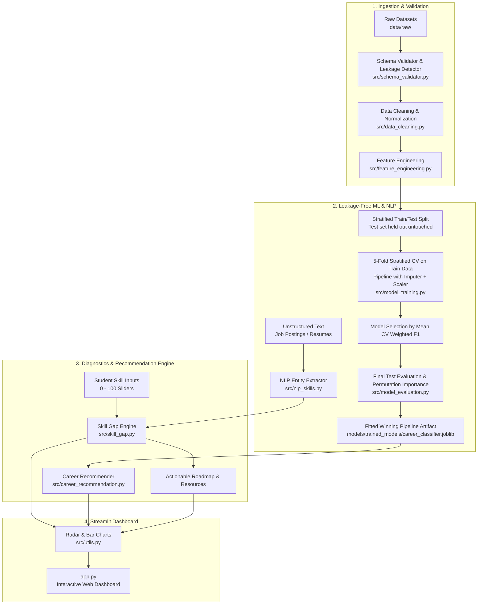

# AI-Based Student Skill Gap Analyzer & Career Recommendation System

[](https://www.python.org/)
[](https://streamlit.io/)
[](https://scikit-learn.org/)
[](https://plotly.com/)
[](https://opensource.org/licenses/MIT)

An end-to-end Data Science, Machine Learning, NLP, and Streamlit web application designed to bridge the gap between academic education and modern industry job requirements through verifiable skill gap diagnostics and personalized learning roadmaps.

---

## 📑 Table of Contents
- [1. Project Overview](#1-project-overview)
- [2. Problem Statement, Motivation & Objectives](#2-problem-statement-motivation--objectives)
- [3. Key Features](#3-key-features)
- [4. Dataset Provenance & Verification Audit](#4-dataset-provenance--verification-audit)
- [5. Complete Data Science Life Cycle](#5-complete-data-science-life-cycle)
- [6. System Architecture](#6-system-architecture)
- [7. Project Folder Structure](#7-project-folder-structure)
- [8. Data Cleaning & Preprocessing Leakage Prevention](#8-data-cleaning--preprocessing-leakage-prevention)
- [9. Feature Engineering & Heuristic Employability Index](#9-feature-engineering--heuristic-employability-index)
- [10. Machine Learning Methodology (Zero Data Leakage)](#10-machine-learning-methodology-zero-data-leakage)
- [11. Permutation Feature Importance](#11-permutation-feature-importance)
- [12. Rule-Based NLP Entity Extraction & Punctuation Support](#12-rule-based-nlp-entity-extraction--punctuation-support)
- [13. Skill Gap Analysis Engine](#13-skill-gap-analysis-engine)
- [14. Career Recommendation Engine (Hybrid Architecture)](#14-career-recommendation-engine-hybrid-architecture)
- [15. Installation & Quickstart Guide](#15-installation--quickstart-guide)
- [16. Model Training & Persistence](#16-model-training--persistence)
- [17. Automated Testing & Quality Assurance](#17-automated-testing--quality-assurance)
- [18. Methodological Limitations & Academic Honesty](#18-methodological-limitations--academic-honesty)
- [19. Future Enhancements](#19-future-enhancements)

---

## 1. Project Overview

The **AI-Based Student Skill Gap Analyzer and Career Recommendation System** quantifies a student's technical competencies, evaluates exact proficiency deficits against 10 modern industry tech career roles, and generates a structured, prioritized upskilling roadmap.

---

## 2. Problem Statement, Motivation & Objectives

### The Problem & Motivation
Graduating computer science and IT students frequently struggle to transition into the industry:
* Academic curricula often lag behind rapidly evolving technology stacks.
* Students lack transparency into exact proficiency benchmarks required for specialized roles (e.g., Data Scientist vs. ML Engineer vs. DevOps).
* Generic career counseling fails to provide prioritized, step-by-step guidance on which skills to tackle first.

### Key Objectives
1. **Verifiable Data Pipeline**: Ingest and standardize datasets with automated schema validation, missing value imputation, deduplication, and bounds clamping \([0, 100]\).
2. **Leakage-Free Machine Learning**: Compare 6 classification algorithms using 5-Fold Stratified Cross-Validation strictly on training splits. Model selection is based on Mean CV Weighted F1-score.
3. **Non-Negative Skill Gap Diagnostics**: Enforce \(\text{Skill Gap} = \max(0, \text{Required} - \text{Current})\) with configurable severity categorization (Mastered, Low, Medium, High).
4. **Transparent Hybrid Recommender**: Combine ML prediction probabilities (40%), Cosine Vector Similarity (35%), and Gap-Readiness Match (25%).
5. **NLP Technical Entity Extractor**: Parse unstructured job descriptions to identify industry-standard technical skills (including `C++`, `C#`, `CI/CD`, `.NET`, `Node.js`, `Power BI`, `AWS`, `Azure`, `GCP`).
6. **Interactive Streamlit Web Dashboard**: Deploy an interactive user interface with polar radar charts, bar charts, and downloadable student employability audit reports.

---

## 3. Key Features

* **⚡ Real-Time Skill Gap Diagnostics**: Evaluate current proficiency against industry benchmarks across 20 technical skills.
* **🎯 Top Career Alignments**: Ranked recommendations with compatibility percentages, supporting strengths, top missing skills, and detailed AI explanations.
* **📚 Prioritized Actionable Learning Roadmaps**: Step-by-step topics, curated online courses, estimated study hours, and portfolio project suggestions for every identified gap.
* **📝 NLP Job Description & Resume Parser**: Paste any job description or resume to extract standardized skills and estimate requirements on the fly.
* **📊 Exploratory Data Analysis (EDA)**: Interactive correlation matrices, career role distributions, and skill boxplots.
* **📄 Downloadable Audit Reports**: Export formal Markdown reports and JSON profiles for student portfolios and mentor reviews.

---

## 4. Dataset Provenance & Verification Audit

In accordance with strict academic honesty, the dataset sources and verification statuses are documented below:

| Dataset Name | Source / Platform | Verification Status | Kaggle URL | License | Rows | Columns | Purpose | Known Limitations |
| :--- | :--- | :--- | :--- | :--- | :---: | :---: | :--- | :--- |
| **Student Career Profiles** | Development Benchmark Fixture | Benchmark Fixture | Not verified | Open Educational Use | 1,500 | 28 | Baseline profiles with 20 technical skill metrics and academic indicators for algorithm prototyping | Generated based on role distributions for benchmark testing; not verified as an independent real-world field survey. |
| **Industry Job Requirements Matrix** | Curated Tech Job Role Baseline Matrix | Curated Archetype Benchmark | Not verified | Open Educational Use | 10 | 21 | Defines baseline proficiency requirements across 10 defined high-demand tech job roles | Represents generalized benchmarks; actual requirements vary across organizations and seniority levels. |
| **Tech Job Postings Corpus** | Development Job Description Corpus | Template-Generated Test Corpus | Not verified | Open Educational Use | 350 | 7 | Corpus of tech job postings used for testing rule-based NLP entity extraction and TF-IDF keyword weighting | Contains recurring template descriptions for NLP testing; does not reflect live unstructured labor market scraping. |

> **Production Dataset Note:** The codebase contains a modular schema validator ([`src/schema_validator.py`](file:///C:/Users/YUVAN/.gemini/antigravity/scratch/student-skill-gap-analyzer/src/schema_validator.py)) that makes the system structurally ready to ingest any authentic external Kaggle or institutional dataset once placed in `data/raw/`.

---

## 5. Complete Data Science Life Cycle

```
[Step 1: Problem Definition]
       │
[Step 2: Data Ingestion & Schema Validation] (src/schema_validator.py, src/data_loader.py)
       │
[Step 3: Data Cleaning & Normalization] ───── (Deduplication, Casing, Score Clamping [0, 100])
       │
[Step 4: EDA & Visualization] ─────────────── (notebooks/02_eda.ipynb, Streamlit Data Explorer)
       │
[Step 5: Feature Engineering] ─────────────── (Domain Indices, Heuristic Employability Index)
       │
[Step 6: Stratified Train/Test Split] ─────── (80/20 Split; Held-Out Test Set Isolated)
       │
[Step 7: 5-Fold Stratified Cross-Validation]  (Pipelines with SimpleImputer + StandardScaler)
       │
[Step 8: Model Selection on CV F1 Score] ──── (Candidate chosen exclusively on Training CV)
       │
[Step 9: Final Test Evaluation (Once)] ────── (Evaluated strictly once on Held-Out Test Set)
       │
[Step 10: Permutation Feature Importance] ─── (sklearn.inspection.permutation_importance)
       │
[Step 11: Skill Gap & Recommender Engine] ─── (Non-negative gaps, Hybrid Recommendation)
       │
[Step 12: Streamlit Interactive App & QA] ─── (Automated Pytest Suite & Interactive UI)
```

---

## 6. System Architecture



---

## 7. Project Folder Structure

```
student-skill-gap-analyzer/
├── app.py                         # Main Streamlit web application
├── requirements.txt               # Pinned project dependencies
├── README.md                      # Academic & technical documentation
├── .gitignore                     # Git ignore rules
├── config/
│   └── config.py                  # Global constants, taxonomies, heuristic weights
├── data/
│   ├── raw/                       # Raw datasets (profiles, requirements, postings)
│   └── processed/                 # Cleaned, standardized, feature-engineered datasets
├── models/
│   └── trained_models/            # Pre-trained pipeline artifacts & metadata JSON
│       ├── career_classifier.joblib
│       ├── label_encoder.joblib
│       └── model_metadata.json
├── notebooks/                     # 4 Academic Jupyter Notebooks
│   ├── 01_data_understanding.ipynb
│   ├── 02_eda.ipynb
│   ├── 03_preprocessing.ipynb
│   └── 04_model_training.ipynb
├── reports/
│   └── figures/                   # Export directory for plots and audit artifacts
├── src/                           # Modular Python Data Science Engine
│   ├── __init__.py
│   ├── data_loader.py             # Schema validation and dataset loading
│   ├── schema_validator.py        # Schema checks and target leakage detector
│   ├── data_cleaning.py           # Deduplication, column mapping, bounds clamping
│   ├── preprocessing.py           # Label encoding, index tracking, leak-free split
│   ├── feature_engineering.py     # Domain indices and Heuristic Employability Index
│   ├── skill_gap.py               # Non-negative gap math, severity ranking, roadmap
│   ├── career_recommendation.py   # Hybrid ML + vector match recommender
│   ├── nlp_skills.py              # Dictionary entity matching, boundary checks, TF-IDF
│   ├── model_training.py          # 5-fold Stratified CV, Weighted F1 selection, pipeline persistence
│   ├── model_evaluation.py        # Permutation feature importance, confusion matrix
│   └── utils.py                   # Plotly charts and markdown report generator
└── tests/
    ├── test_functions.py          # Automated Pytest suite (13 tests)
    └── fixtures/
        └── generate_test_fixtures.py  # Offline test fixture generator (Test only)
```

---

## 8. Data Cleaning & Preprocessing Leakage Prevention

### Preprocessing Leakage Prevention
> **Methodological Guarantee:** The preprocessing pipeline is fitted strictly on training data. Statistical parameters (such as medians for imputation and standard deviations for feature scaling) are **never** calculated across the full dataset prior to splitting.
>
> All learned transformers (`SimpleImputer`, `StandardScaler`) are encapsulated inside an `sklearn.pipeline.Pipeline`, guaranteeing that fold validation and held-out test splits remain isolated.

### Cleaning Rules
* **Header Standardization**: Maps heterogeneous column aliases (e.g. `python_skill`, `ML_Proficiency`, `PowerBI_Tableau_Visuals`) to canonical system identifiers.
* **Deduplication**: Drops duplicate records based on `Student_ID`.
* **Score Clamping**: Enforces strict \([0, 100]\) constraints on all skill scores and \([0, 10]\) on GPA.

---

## 9. Feature Engineering & Heuristic Employability Index

### 1. Domain Competency Indices
Composite averages derived from raw skill groups:
* `Prog_Core_Index`: Mean of Python, Java, C++, JavaScript, R, Problem Solving.
* `Data_Analytics_Index`: Mean of SQL, Data Analysis, Visualization, Statistics, Database Design, Big Data.
* `AI_Intelligent_Index`: Mean of Machine Learning, Deep Learning, NLP.
* `Cloud_DevOps_Index`: Mean of Cloud Computing, DevOps CI/CD, Docker/Kubernetes, Cybersecurity.

### 2. Heuristic Employability Index
$$\text{Employability Index} = 0.50 \cdot \text{Overall Skill Score} + 0.20 \cdot \text{GPA Score} + 0.15 \cdot \text{Project Score} + 0.15 \cdot \text{Experience Score}$$

> **Academic Disclaimer:** The Employability Index is a rule-based composite indicator designed for descriptive guidance. It is **not** an ML-learned statistical outcome. The weighting coefficients are architectural design parameters.

---

## 10. Machine Learning Methodology (Zero Data Leakage)

1. **Stratified Split**: The dataset is partitioned into Training (80%) and Held-Out Test (20%) sets using `stratify=y, random_state=42`.
2. **Encapsulated Pipelines**: Every candidate model is wrapped in an `sklearn.pipeline.Pipeline` with `SimpleImputer(strategy="median")` and `StandardScaler()`.
3. **5-Fold Stratified Cross-Validation**: Candidate models are benchmarked exclusively on the Training Split (`X_train`, `y_train`).
4. **Model Selection**: The winning algorithm is selected strictly based on **Mean CV Weighted F1-Score**.
5. **Final Evaluation**: The winning pipeline is fitted on the full training set and evaluated **once** on the untouched held-out test set.

### 5-Fold Stratified CV Benchmark Results (Training Split Only)

> **Benchmark Evaluation Notice:** The baseline CV and test evaluation metrics reported below reflect the development benchmark dataset fixtures. Final model performance is pending retraining on the verified production dataset once supplied.

| Candidate Algorithm | Mean CV Weighted F1 | CV Std F1 | Mean CV Accuracy | CV Std Accuracy | Selection Status |
| :--- | :---: | :---: | :---: | :---: | :---: |
| **Support Vector Machine (SVC)** | **0.9260** | **0.0199** | **0.9267** | **0.0193** | 🏆 **Winning Model** |
| **Logistic Regression** | 0.9182 | 0.0145 | 0.9192 | 0.0136 | Evaluated |
| **Random Forest** | 0.9162 | 0.0078 | 0.9167 | 0.0075 | Evaluated |
| **K-Nearest Neighbors (KNN)** | 0.8952 | 0.0128 | 0.8958 | 0.0126 | Evaluated |
| **Gradient Boosting** | 0.8899 | 0.0129 | 0.8900 | 0.0125 | Evaluated |
| **Decision Tree** | 0.8144 | 0.0129 | 0.8150 | 0.0120 | Evaluated |

### Final Held-Out Test Evaluation (Single Evaluation of Winning Pipeline)
* **Test Accuracy:** `91.00%`
* **Test Weighted F1-Score:** `90.95%`
* **Test Weighted Precision:** `91.00%`
* **Test Weighted Recall:** `91.00%`

---

## 11. Permutation Feature Importance

For post-hoc model interpretation, **Permutation Feature Importance** is computed on the held-out test split over 10 repeats using `sklearn.inspection.permutation_importance(scoring='f1_weighted')`.

> **Note:** Permutation feature importance measures the decrease in model F1-score when a specific feature's values are randomly shuffled. It is used strictly for post-hoc interpretation and is **never** used for model selection.

### Top Influential Features on Test Split
1. **JavaScript** (Mean F1 Decrease: 7.16% ± 1.04%)
2. **C++** (Mean F1 Decrease: 4.79% ± 1.03%)
3. **Cybersecurity Basics** (Mean F1 Decrease: 4.17% ± 0.64%)
4. **DevOps & CI/CD** (Mean F1 Decrease: 3.96% ± 1.27%)
5. **NLP** (Mean F1 Decrease: 3.56% ± 0.90%)

---

## 12. Rule-Based NLP Entity Extraction & Punctuation Support

The NLP module parses unstructured text (job postings and resumes) to identify industry requirements:
* **Methodology**: Deterministic rule-based dictionary entity matching with token boundary isolation and TF-IDF keyword salience.
* **Special Term Support**: Accurately recognizes punctuation-heavy technical terms without regex lookbehind syntax errors:
  * `C++`, `C#`, `CI/CD`, `.NET`, `Node.js`, `Power BI`, `AWS`, `Azure`, `GCP`.
* **Semantic Distinctness**:
  * `C#` is mapped strictly to `C#` (and never mapped to `C++`).
  * `.NET` is mapped strictly to `.NET` (and never mapped to `Java`).

---

## 13. Skill Gap Analysis Engine

### Formulation
For any selected career role:
$$\text{Skill Gap} = \max(0.0, \text{Required Benchmark Level} - \text{Student Proficiency Level})$$

* If \(\text{Student Proficiency} \ge \text{Required Benchmark}\), \(\text{Gap} = 0\) (*Mastered / Sufficient*).
* Gaps are strictly non-negative.

### Severity Categories (Configurable)
* **Mastered / Sufficient (0 pts)**: Student meets or exceeds industry requirements.
* **Low Priority Gap (1 – 15 pts)**: Minor deficit requiring quick refresher practice.
* **Medium Priority Gap (16 – 35 pts)**: Moderate deficit requiring targeted coursework.
* **High Priority Gap (> 35 pts)**: Critical competency deficit requiring dedicated projects and study.

---

## 14. Career Recommendation Engine (Hybrid Architecture)

$$\text{Hybrid Match} = 0.40 \cdot \text{ML Probability} + 0.35 \cdot \text{Cosine Similarity} + 0.25 \cdot \text{Readiness Match}$$

```python
HYBRID_WEIGHTS = {
    "ml_probability": 0.40,      # 40% Weight from calibrated ML classifier pipeline
    "vector_similarity": 0.35,   # 35% Weight from 20-dimensional skill vector cosine similarity
    "readiness_match": 0.25      # 25% Weight from percentage of mastered requirements
}
```

> **Academic Transparency Note:** The hybrid recommendation weights are heuristic design parameters chosen for multi-criteria decision making. They are not statistically learned or gradient-optimized model parameters.

---

## 15. Installation & Quickstart Guide

### Prerequisites
* Python 3.10.x
* Pip package manager

### Step 1: Clone or Navigate to Project Directory
```bash
cd student-skill-gap-analyzer
```

### Step 2: Create and Activate Virtual Environment
**On Windows:**
```bash
python -m venv venv
venv\Scripts\activate
```

**On macOS / Linux:**
```bash
python3 -m venv venv
source venv/bin/activate
```

### Step 3: Install Pinned Dependencies
```bash
pip install -r requirements.txt
```

### Step 4: Launch Streamlit Application
```bash
streamlit run app.py
```
Open `http://localhost:8501` in your browser.

---

## 16. Model Training & Persistence

To re-run the 5-fold cross-validation and generate updated model artifacts:
```bash
python src/model_training.py
```
This saves:
* Fitted winning pipeline: `models/trained_models/career_classifier.joblib`
* Label encoder: `models/trained_models/label_encoder.joblib`
* Complete audit metadata: `models/trained_models/model_metadata.json`

---

## 17. Automated Testing & Quality Assurance

Run the automated Pytest test suite:
```bash
pytest -v
```

### Test Coverage (13 Automated Tests)
* `test_data_loader_and_schema`: Ingestion and structural schema verification.
* `test_schema_validator_missing_column_error`: SchemaValidationError on missing critical columns.
* `test_target_leakage_detection`: Target leakage detection and clean feature verification.
* `test_data_cleaning_and_bounds`: Deduplication, missing imputation, and [0, 100] score clamping.
* `test_feature_engineering`: Domain indices and Employability Index derivation.
* `test_skill_gap_math`: Non-negative gap calculations and clamping.
* `test_skill_gap_severity_and_roadmap`: Severity threshold categorization and roadmap generation.
* `test_career_recommendations_normal`: Top career recommendations and explanation generation.
* `test_career_recommendations_edge_cases`: Safe handling of empty and all-zero profiles.
* `test_nlp_skill_extraction_special_terms`: Accurate extraction of `C++`, `C#`, `CI/CD`, `.NET`, `Node.js`, `Power BI`, `AWS`, `Azure`, `GCP`.
* `test_nlp_distinctness_csharp_not_cpp_and_dotnet_not_java`: Verifies `C# != C++` and `.NET != Java`.
* `test_nlp_empty_and_invalid_input`: Graceful handling of empty or non-string inputs.
* `test_model_loading_and_prediction`: Pipeline loading and calibrated probability output.

---

## 18. Methodological Limitations & Academic Honesty

1. **Dataset Scope**: The baseline model was trained on 1,500 benchmark student career profiles across 10 defined career roles. Real-world job markets encompass broader hybrid titles.
2. **Heuristic Hybrid Weights**: The recommendation weights (40% ML, 35% Vector Sim, 25% Readiness) are architectural design parameters, not learned weights.
3. **Rule-Based NLP**: The NLP parser uses dictionary-based entity matching and tokenization within its defined taxonomy. It identifies recognized skills in its dictionary and does not perform deep semantic dependency parsing.
4. **Employability Index**: The composite Employability Index is a heuristic proxy reflecting academic GPA, project count, experience, and skill proficiencies.
5. **Decision Support Nature**: Career alignments and skill gaps serve as educational guidance and decision-support, not guaranteed placement outcomes.

---

## 19. Future Enhancements

* **LLM-Powered Dynamic Syllabi**: Integrate Gemini API for generating customized weekly study schedules.
* **Direct PDF Resume Parser**: Upload PDF resumes directly using OCR and document parsing.
* **Live Job Market Ingestion**: Scrape live postings from public APIs to dynamically update role requirement benchmarks.
* **Multi-Student University Dashboard**: Placement cell portal to track batch-wide skill gaps.

---

## 📄 License
This project is open-source and licensed under the **MIT License**.
